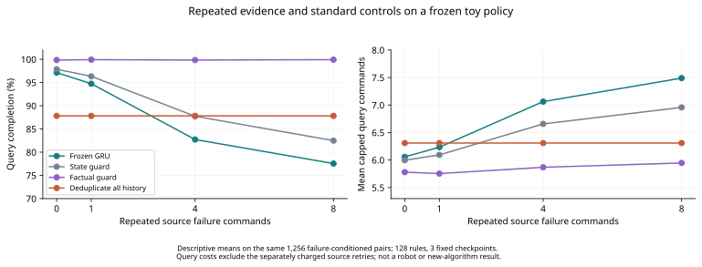

# 重复失败反馈与冻结策略的证据利用

2026年10月14日。本轮完成21,216条查询分支，得到两个具体结果：普通事实约束改善了已有冻结策略；删除全部重复失败反馈反而使该策略更容易陷入循环。这些结果用于筛除不必要的方法复杂度，当前新算法判断仍为RETHINK。

## 问题与实验范围

固定研究问题是：机器人能否从自己的纠正经验中学到可复用的任务关系，并用于此前没有执行过的新目标？本轮考察其中的证据利用环节。环境包含5个操作及未知、固定的前置条件图，状态公开，结果确定。128个新关系类与1,271个历史关系类无交叠；每类4组不同源目标与查询目标，3个已有冻结GRU检查点。教师和隐藏关系不进入部署决策。

源阶段最多执行4次命令，到首次非平凡失败即停，随后重置物理状态并执行新目标。这是短源记录诊断，未完成的源任务不能写成完整部署工作流。所有1,536个检查点—目标对进入零重复比较；另外1,256个源失败对进入1/4/8次实际重复比较。置信区间按128个关系类聚类重采样4,000次，条件于这3个检查点。21,216是查询分支数，不是独立样本数。

## 标准事实约束

令P_a是操作a的未知父操作集合，S是已完成操作集合。每个操作保留16种可能父集合。对公开、尚未完成的操作反馈e，用标准版本空间更新

\[
\mathcal V_{a,t+1}=\{P\in\mathcal V_{a,t}:\mathbf1[P\subseteq S_t]=y_t\}.
\]

若不存在P∈V使P⊆S，则该命令已知不可执行。fact_guard将其屏蔽，并沿用state_guard对已完成命令和过早STOP的屏蔽。它不读取隐藏任务图，也不包含联合DAG后验或Bayes规划。

在此确定性通道下，同一状态的相同失败满足L_M(e)∈{0,1}，因此

\[
p(M\mid H,e,e)=p(M\mid H,e).
\]

这是模型假设下的普通推断性质。随机噪声、隐状态或环境改变下，重试可能提供新信息。

## 全部零重复案例

| 对照 | 完成率 | 平均截断查询命令 | 已知不可执行命令 |
|---|---:|---:|---:|
| 原始冻结GRU | 97.266% | 6.0046 | 411 |
| 公开进度约束 | 97.852% | 5.9531 | 392 |
| 事实约束 | 99.740% | 5.7474 | 0 |
| 全程删除重复失败 | 87.695% | 6.2669 | 1,460 |

事实约束相对进度约束提高1.888个百分点，95%区间[0.846,3.192]；平均节省0.2057条查询命令，区间[0.1536,0.2585]。三检查点分别多完成12/7/10个目标，节省124/96/96条命令。这里测量物理命令成本；未比较各臂推断时间或内存前沿。

四个对照的第一次查询动作完全一致。逐条匹配后，state_guard与fact_guard在216/1,536个案例首次分歧，均发生在第一次动作之后。其中52次的屏蔽可以由源记录单独推出，164次可以由查询记录单独推出，没有同时或必须联合两者才成立的案例。前一类别整条轨迹净多完成2个目标、节省82条命令，后一类别净多完成27个、节省234条命令。按首次分歧分类的轨迹差值不是source/query机制的因果分解；没有source-only和query-only策略消融。

这既留下了后续复用源约束的实例，也明确表明主要收益来自执行中的纠正。它不证明未执行新目标的第一次动作更优。

## 相同失败的重复与去重

下面只比较相同的1,256个源失败对，零重复行也限制到该子集。

| 源阶段重复次数 | 原始策略完成率 | 事实约束完成率 | 全程去重完成率 | 原始策略平均查询命令 |
|---|---:|---:|---:|---:|
| 0 | 97.134% | 99.841% | 87.818% | 6.0581 |
| 1 | 94.745% | 99.920% | 87.818% | 6.2349 |
| 4 | 82.723% | 99.841% | 87.818% | 7.0629 |
| 8 | 77.548% | 99.920% | 87.818% | 7.4896 |

重复8次时，原始策略的第一次动作在39.89%的配对中改变，完成率下降19.586个百分点，95%区间[-23.065,-16.180]；查询命令增加1.4315。加上8次实际重试，总截断命令单位增加9.4315，区间[9.2317,9.6304]。每条查询计一次reset；命令单位不是实物秒数。

全程去重在零重复总体上降低9.570个百分点，区间[-11.589,-7.617]。189条去重失败中188条重新访问完全相同的去重输入、状态与目标。固定输入加确定性贪心决策导致局部吸收循环，这解释了去重不能当作现成修复。原始策略能否利用重复进行有意义的规划，仍未识别。

图为相同失败子集的均值，不含绝对完成率区间；配对差值区间见正文。右图不含已经单独计费的源阶段重试。

## 算法与论文判断

简单事实约束已经消除本轮已知不可执行命令和查询内重复，并将完成率稳定在接近100%。因此，本轮不能用这些缺陷来主张C15/C21/C12复杂记忆机制的必要性；这些候选也没有在本轮被实现或被直接否证。

“重复反馈有害”不是完整结论：本轮同时观察到源重复的负影响和删除查询重复的负影响。不能从动作变化反推出神经后验被污染，也不能把脱离循环叫作规划。下一算法必须优于携带相同事实约束的强控制，且作用于确实存在的剩余决策误差或资源瓶颈。

[直接前作核查](LITERATURE_CHECK.md) 补入了Zeva及内部计算与pacing研究；交互经验复用和额外内部思考不能独立承担新颖性。当前没有必要继续放大这个已被普通约束覆盖的符号缺陷来包装新算法。

## 执行与复核

唯一正式运行使用CPU2线程，总进程墙钟14.410秒；模型加载、rollout和统计11.969秒，后者不含最后文件序列化。正式运行记录2,314次源transition、16,328次padding transition、133,531次查询transition，合计152,173次；21,216次分支reset另计。源记录在匹配对照之间复用，不作为免费部署采集收益。另有一次开发smoke的156条分支及1,102次transition，单独记账。新增训练0、机器人回合0。

六项语义与cohort回归测试通过。初次审阅发现历史排除遗漏并阻止启动，修复后复审和smoke通过；原BLOCKED记录保留。结果经同模型家族代理独立读取CSV复核，这属于暂定审阅，不是跨模型接受。

[固定协议](PROTOCOL.md) · [复审](CODE_REVIEW_002.md) · [科学评审](SCIENCE_REVIEW.md) · [原始统计](results-main/result.json) · [事件记录](results-main/query_events.csv) · [配对结果](results-main/episodes.csv) · [源记录](results-main/source_histories.json)
